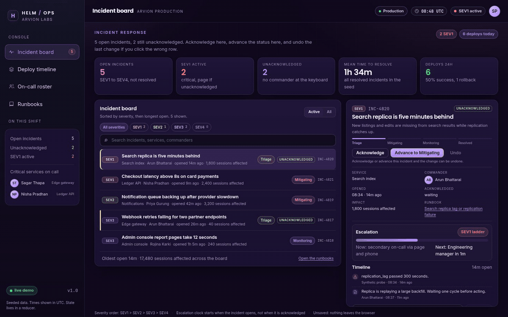

<div align="center">

</div>

<sub>Recorded from the live demo &middot; <a href="docs/demo.mp4">MP4</a> &middot; <a href="docs/screenshot.png">static frame</a></sub>

# Helm Ops

An operations console for the people who get paged. Incidents are triaged on a
severity board, deploys are plotted on a timeline with rollback markers, the
on-call roster shows who is next, and every service keeps its runbook one
keystroke away. React 19 with a typed reducer instead of a state library, so
every status change is one testable action.

[**Live demo**](https://arvion-technology.github.io/labs/demos/helm-ops/demo/) &middot; [MIT](LICENSE)

---

## What it does

- **Incident board:** severity, owner and acknowledgement state, with a reduction
  of the board into counts by severity for the header.
- **Status flow:** an incident moves `open -> acknowledged -> mitigated -> closed`,
  or reopens. Illegal transitions are rejected by the reducer, not by hiding a button.
- **Deploy timeline:** each deploy carries a service, a revision, a state and an
  optional rollback pointer, rendered on a shared time axis.
- **On-call roster:** primary and secondary per rotation, with the next handover
  time computed from the rotation length.
- **Runbooks:** searchable, linked to a service, and reachable from an incident.
- **Undo:** the status history can be stepped back one action at a time.

## How it is built

React 19 and TypeScript, bundled by Vite, no UI framework. State lives in a
reducer (`src/state/`) with pure selectors (`src/selectors/`) and seeded data
(`src/data/seed.ts`); the views only render what the selectors return. Formatting
helpers (relative time, durations) are pure functions with tests.

```
src/
  state/reducer.ts     incidents, deploys, roster, undo
  selectors/           board, timeline, roster and runbook queries
  views/               IncidentBoard, DeployTimeline, Roster, Runbooks
  data/seed.ts         a realistic, deterministic demo day
test/                  reducer, selectors, data and format tests
```

The demo in `demo/` is the production Vite build copied with relative paths, so
the gallery can serve it without a server.

## Run it

```bash
npm ci
npm run dev        # local development
npm test           # node:test on reducer and selectors
npm run typecheck
npm run build      # dist/ plus demo/ for the static gallery
```

## Tests

Four suites cover the reducer transitions and undo, the selectors, the seeded
data invariants and the time formatting helpers. `npm test` runs them on Node's
test runner with no test framework dependency.

## Honest limitations

- State is local and seeded. There is no backend, no real incident feed and no
  authentication; connecting a paging provider is the obvious next step.
- The roster is a static rotation, not a schedule with swaps or escalations.
- Undo steps back status changes only. Deploy and roster edits are not undoable.

## What to look at first

Open the incident board and acknowledge an incident: the header counts and the
row status both change because the reducer produced a new state. Then open the
deploys tab and follow a rollback marker back to the incident it belongs to; the
timeline and the board read the same seeded day, which is the point of keeping
selectors pure. The demo records this flow in `docs/demo.gif`.

## License

MIT. See [LICENSE](LICENSE).
